<div align="center">

# SpaceFire AI

### From NASA Data to Fire Safety Insights

**An interactive research platform that brings ten NASA microgravity combustion investigations together through
scientific data exploration, interactive 3D visualization and evidence-grounded AI assistance.**

[The Challenge](#the-challenge) · [Features](#key-features) · [Gallery](#platform-preview) ·
[NASA Datasets](#nasa-datasets) · [Architecture](#system-architecture) · [Run it locally](#installation-and-local-demo) ·
[Limitations](#scientific-accuracy-and-limitations)

</div>

<p align="center">
  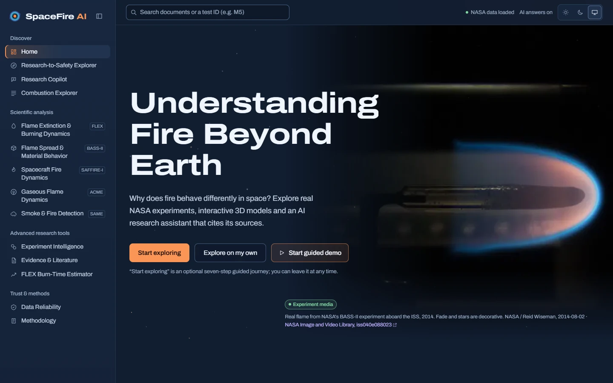
</p>

| | |
|---|---|
| **Event** | NASA Space Apps Challenge 2026: *Flame in Freefall: AI-Powered Fire Safety Insights from Microgravity Combustion Data* |
| **Research area** | Microgravity combustion, spacecraft fire safety, scientific data exploration |
| **Built with** | Next.js · React · TypeScript · three.js · FastAPI · Python · SQLite · Gemini (optional) |
| **Data** | Public NASA Physical Sciences Informatics (PSI) investigations: ten in total, across five scientific domains |

> SpaceFire AI is an independent hackathon project. It is not affiliated with or endorsed by NASA.

---

## The Challenge

**On Earth, fire depends on gravity.** Hot combustion gases rise, fresh air flows in underneath, and a flame takes its
familiar teardrop shape. **In microgravity, buoyancy disappears.** Flames become slow, near-spherical and governed by
diffusion and by the ventilation airflow of the cabin. Droplet flames can go out and continue as barely visible
*cool flames*. Materials that self-extinguish on Earth can keep burning in a slow airflow.

**Spacecraft are closed cabins with no escape.** Crew safety depends on understanding how fires ignite, spread and
produce smoke in these conditions, and on detecting them early.

**NASA has flown many combustion experiments, but the evidence is hard to use together.** It is scattered across
investigations, CSV tables, final reports, figure data, flight logs and metadata, each with a different structure,
units and level of completeness.

**SpaceFire AI makes this evidence explorable.** It starts from a research question, finds the relevant NASA
investigations, and shows exactly what was measured, where it came from, and what the data cannot tell you.

## Our Solution

```
NASA investigations  →  curated scientific data  →  research exploration  →  scientific visualization  →  evidence-grounded AI
 (PSI data, reports,     (SQLite, provenance,         (Research-to-Safety,      (charts, five 3D studios,     (Research Copilot with
  figures, metadata)      knowledge graph)             Combustion Explorer)      NASA media)                   verified citations)
```

- **Curated, not pooled.** Each investigation is a different physical system. SpaceFire processes each one at the
  evidence level its files actually support and never merges them into a single dataset or model.
- **Traceable.** Every value carries its source: the CSV row, the report page or the external record.
- **Honest about evidence.** The app labels each item as measured, report-derived, model output, test conditions or
  a conceptual illustration.

## Key Features

| Feature | What you can do | Route |
|---|---|---|
| **Research-to-Safety Explorer** | Start from a spacecraft fire research question (flame spread over cabin materials, gaseous flames, early smoke detection, droplet flame extinction). SpaceFire then ranks the relevant NASA investigations with a transparent relevance score and shows supporting evidence, key charts, an interpretation and the limitations. | `/safety-explorer` |
| **Combustion & Fire Science Explorer** | Browse records and research collections from all ten investigations across five scientific domains, with dataset-specific filters, provenance on every record, and side-by-side comparison only where records are compatible. | `/experiments` |
| **Interactive 3D Studios** | Five studios (droplet flame, flame spread, spacecraft fire, gaseous flame, smoke detection). They explain each phenomenon with play/pause, guided timelines, Earth vs microgravity views, part labels and a fullscreen mode. Measured NASA values appear in a separate evidence panel. | `/phenomena/*#studio` |
| **Scientific Analysis** | Investigate source-backed measurements: the FLEX extinction map, d²-law consistency check, BASS-II report tables, CFI-G outcomes and cool-flame events, SAME particle sizes, and PSI-117 experiment vs model series. | `/phenomena/*` |
| **Research Copilot** | Ask a scientific question. It retrieves NASA document passages, curated records and knowledge-graph facts. With a Gemini key it writes an answer whose citations and numbers are verified in code; without one it shows the evidence only. It declines safety-certification and prediction requests. | `/copilot` |
| **Find Similar Experiments** | Find tests with similar *starting conditions* (Gower distance) in FLEX, BASS-II or ACME CFI-G. This searches only the locally processed NASA records, **not Google or the internet**, and never uses outcomes to measure similarity. | `/intelligence/similar` |
| **Scientific Media & Document Evidence** | Search NASA reports with page-level citations, look up external literature (NASA NTRS, OpenAlex, Crossref), and browse 15 verified NASA photos, clips and animations, each credited and labelled. | `/evidence`, `/evidence/media` |
| **Guided Demo** | Follow a five-step presentation through the challenge, a research scenario, NASA evidence, a 3D studio and the Copilot. A six-step guide is also available inside the Combustion Explorer. | `/demo` |

Also included: a **Data Reliability** browser that traces each quality flag to its file, row and column (`/reliability`),
a **Methodology** page (`/methodology`), Light/Dark/System themes, and an **Exploratory FLEX Burn-Time Estimator**
(`/modeling`), an advanced research tool with a visible validation summary that is not a physical simulation.

## Platform Preview

<p align="center">
  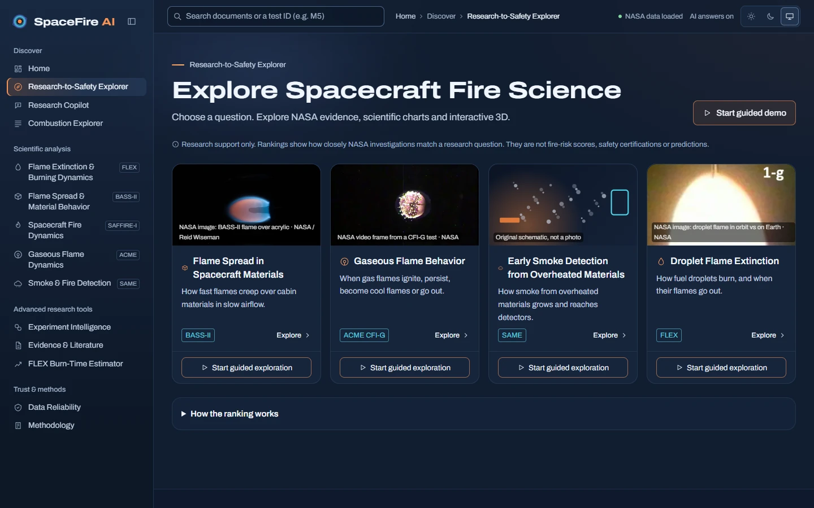
  <br><sub><b>Research-to-Safety Explorer</b>: discover NASA investigations through spacecraft fire research questions.</sub>
</p>

### Interactive Scientific Exploration

<table>
  <tr>
    <td width="50%">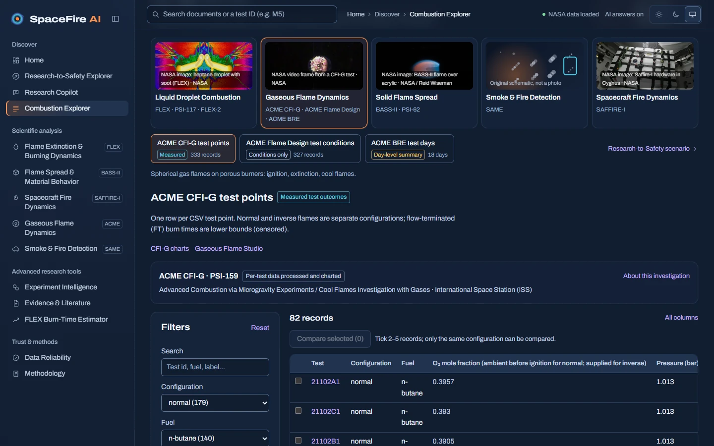</td>
    <td width="50%">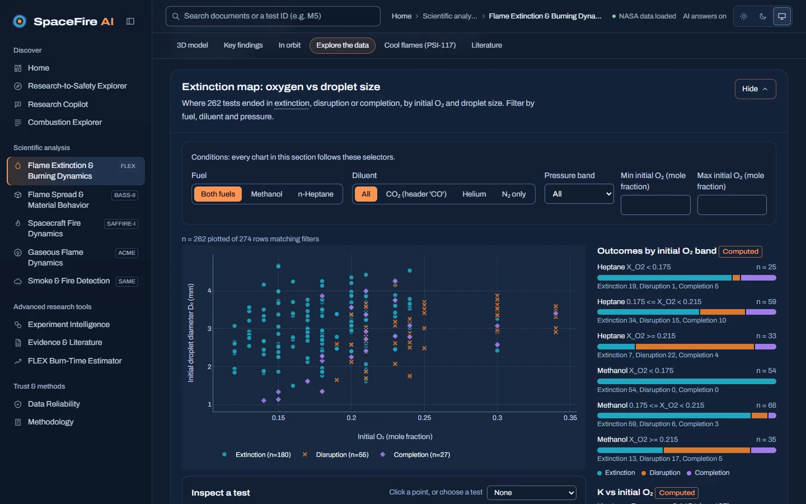</td>
  </tr>
  <tr>
    <td><sub><b>Combustion & Fire Science Explorer</b>: five domains, ten investigations, each labelled with its evidence level (here: ACME CFI-G, normal n-butane flames).</sub></td>
    <td><sub><b>Scientific Analysis</b>: FLEX extinction map, with 262 of 274 tests plotted by initial O₂ and droplet size, plus outcome bars by O₂ band.</sub></td>
  </tr>
</table>

### Interactive 3D Studios

<table>
  <tr>
    <td width="50%">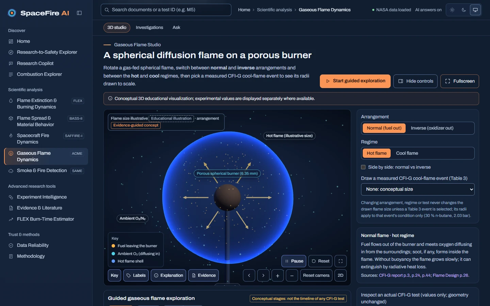</td>
    <td width="50%">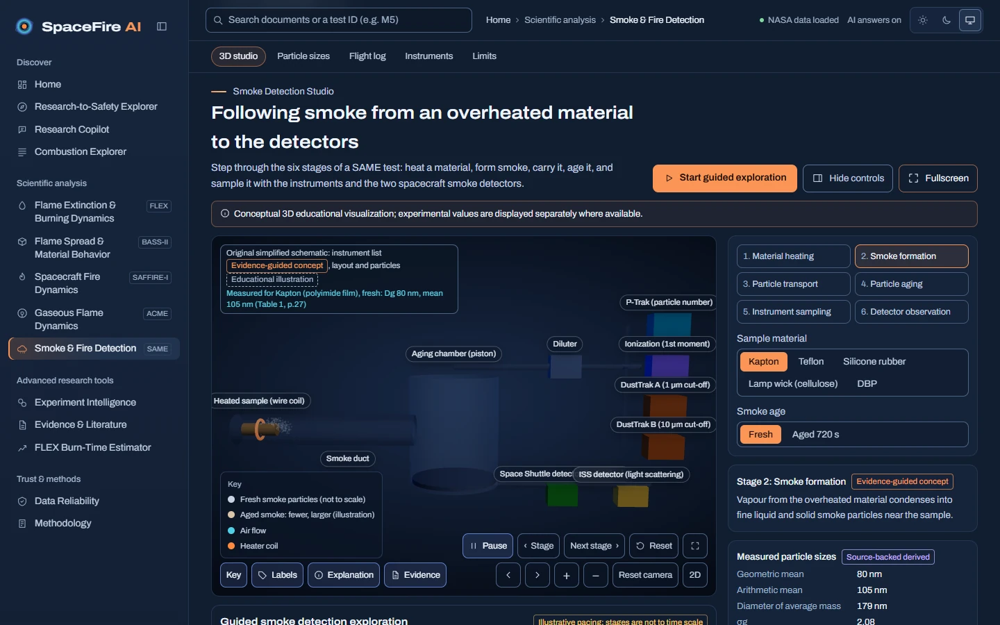</td>
  </tr>
  <tr>
    <td><sub><b>Gaseous Flame Studio</b>: a spherical diffusion flame on a porous burner, paused on the "Established flame" stage of the guided timeline (conceptual 3D).</sub></td>
    <td><sub><b>Smoke Detection Studio</b>: SAME smoke from heated sample to detectors, with measured Kapton particle sizes (Table 1, p.27) beside the conceptual scene.</sub></td>
  </tr>
  <tr>
    <td width="50%">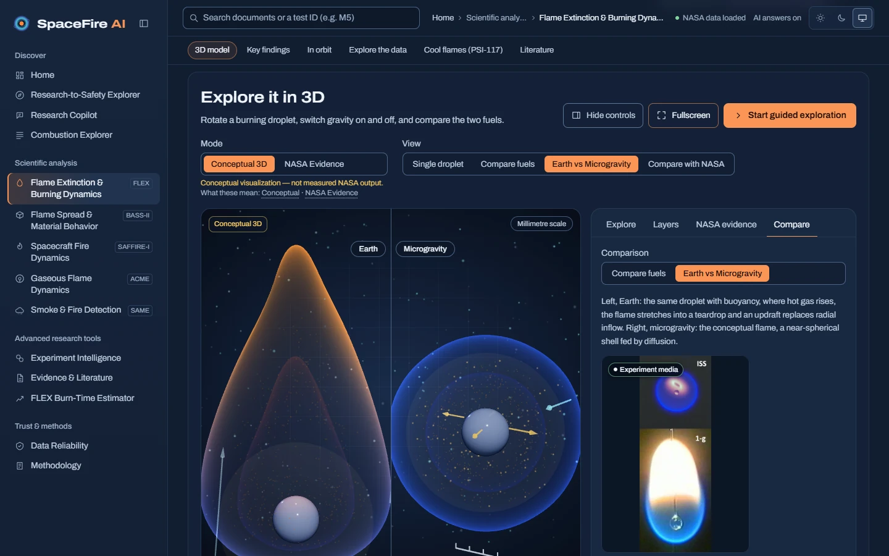</td>
    <td width="50%">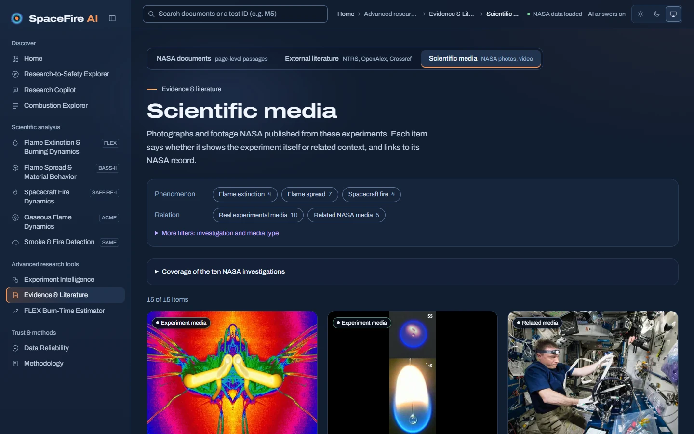</td>
  </tr>
  <tr>
    <td><sub><b>Earth vs microgravity</b>: the FLEX droplet studio places a buoyant teardrop flame beside a near-spherical one, next to real NASA imagery.</sub></td>
    <td><sub><b>Scientific Media</b>: verified NASA photographs, footage and animations, each labelled as experiment or related media.</sub></td>
  </tr>
</table>

### Evidence & Research Tools

<table>
  <tr>
    <td width="50%">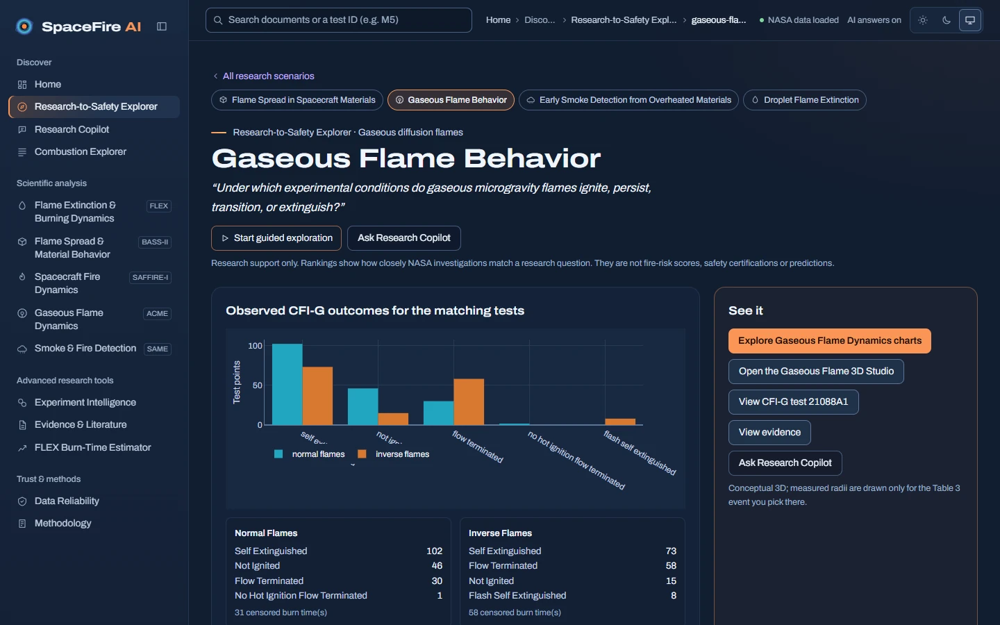</td>
    <td width="50%">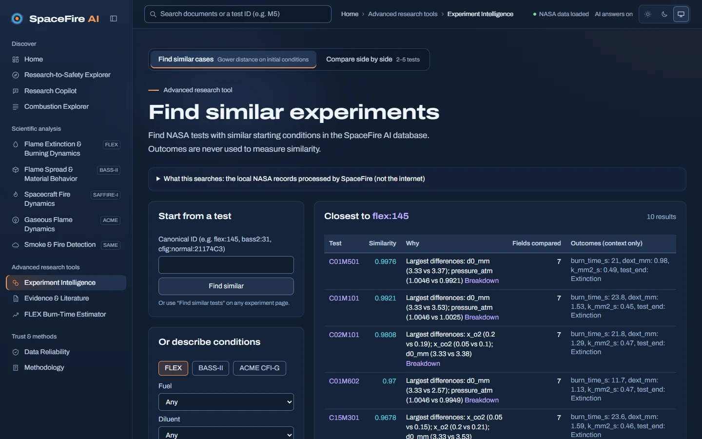</td>
  </tr>
  <tr>
    <td><sub><b>Research scenario</b>: observed CFI-G outcomes for the matching tests, with links to charts, the 3D studio, evidence and the Copilot.</sub></td>
    <td><sub><b>Find Similar Experiments</b>: nearest FLEX tests by starting conditions in the local NASA database, with the reason for each match.</sub></td>
  </tr>
</table>

### AI & Guided Research

<table>
  <tr>
    <td width="50%">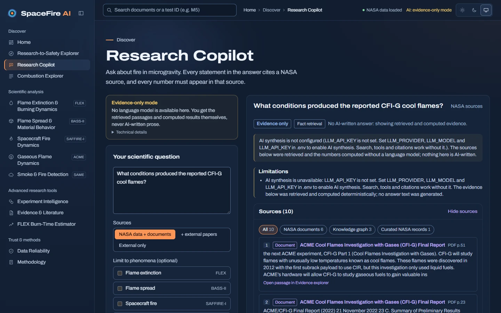</td>
    <td width="50%">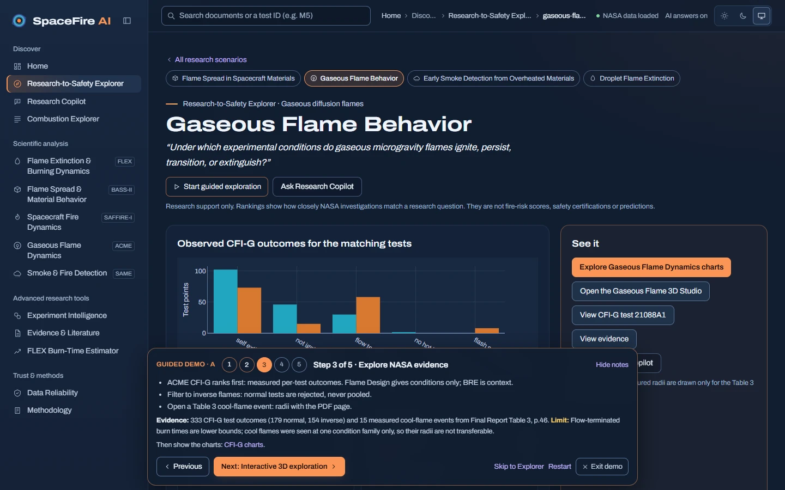</td>
  </tr>
  <tr>
    <td><sub><b>Research Copilot</b>, shown in <i>evidence-only mode</i> (no AI key configured): retrieved CFI-G Final Report passages with PDF page citations; nothing in this view is AI-written.</sub></td>
    <td><sub><b>Guided Demo</b>: step 3 of 5, "Explore NASA evidence", with presenter notes, evidence and limits for the scenario.</sub></td>
  </tr>
</table>

<sub>All images are real screenshots of the running application (1440 × 900, dark theme). See
<a href="docs/README_REFRESH_REPORT.md">docs/README_REFRESH_REPORT.md</a> for how each one was captured.</sub>

## NASA Datasets

SpaceFire tracks **ten NASA investigations across five scientific domains**. They do not all provide the same kind of
data. Some contain measured per-test outcomes, others only test conditions, report tables, published figure data or
metadata. SpaceFire uses each one **at its real evidence level** and labels it that way throughout the interface.

| Investigation | Scientific domain | Available evidence in SpaceFire | Application usage |
|---|---|---|---|
| **FLEX** ([PSI-69](https://psi.nasa.gov/physci/repo/data/investigations/PSI-69)) | Liquid Droplet Combustion | **Measured test outcomes**: 274 experimental records (methanol, n-heptane droplets on the ISS) | Explorer, extinction and d²-law charts, droplet 3D studio, similarity, Copilot, exploratory estimator |
| **FLEX-2** ([PSI-68](https://psi.nasa.gov/physci/repo/data/investigations/PSI-68)) | Liquid Droplet Combustion | **Test plan and documents**: 8 rows describing the planned test-matrix envelope; no downloaded per-test outcomes | Explorer (labelled "test plan"), Flame Extinction page, Copilot documents |
| **PSI-117**: Cool Flame Dynamics ([PSI-117](https://psi.nasa.gov/physci/repo/data/investigations/PSI-117)) | Liquid Droplet Combustion | **Published figure data**: 61 series, experiment vs 1-D sphero-symmetric model. These are not tests, and not a 3D CFD dataset | Explorer, cool-flame charts on the Flame Extinction page |
| **ACME CFI-G** ([PSI-159](https://psi.nasa.gov/physci/repo/data/investigations/PSI-159)) | Gaseous Flame Dynamics | **Test conditions with observed outcomes**: 333 test points (179 normal, 154 inverse flames, never pooled) plus 15 measured cool-flame events from Final Report Table 3 | Explorer, CFI-G charts, gaseous flame 3D studio, similarity, Research-to-Safety |
| **ACME Flame Design** ([PSI-10](https://psi.nasa.gov/physci/repo/data/investigations/PSI-10)) | Gaseous Flame Dynamics | **Conditions only**: 327 test-condition records; outcomes appear only as author findings in the report | Explorer, Gaseous Flame page |
| **ACME BRE** ([PSI-20](https://psi.nasa.gov/physci/repo/data/investigations/PSI-20)) | Gaseous Flame Dynamics | **Day-level summaries**: 18 test days and published report findings; no individual flame-test measurements | Explorer, Gaseous Flame page, Research-to-Safety context |
| **BASS-II** ([PSI-25](https://psi.nasa.gov/physci/repo/data/investigations/PSI-25)) | Solid Flame Spread | **Measured runs**: 129 experimental records, plus Summary Report Tables 5.1, 7.1 and Appendix A | Explorer, flame-spread charts, flow-duct 3D studio, similarity, Copilot |
| **PSI-62**: Flame Spread Modeling ([PSI-62](https://psi.nasa.gov/physci/repo/data/investigations/PSI-62)) | Solid Flame Spread | **Metadata only**: investigation profile; no data files | Explorer investigation profile, registry |
| **SAME** ([PSI-102](https://psi.nasa.gov/physci/repo/data/investigations/PSI-102)) | Smoke & Fire Detection | **Documented smoke-particle results and flight log**: 8 particle-size results (Final Science Report Table 1) and a 47-test flight log; the raw 1 Hz telemetry is inventoried but not processed | Explorer, Smoke Detection page and 3D studio, Research-to-Safety |
| **SAFFIRE-I** ([PSI-98](https://psi.nasa.gov/physci/repo/data/investigations/PSI-98)) | Spacecraft Fire Dynamics | **Spacecraft-scale experiment context**: 2 burn records, 2 image-set records and a 12-sheet image manifest from the 2016 uncrewed Cygnus burn | Spacecraft Fire page and 3D studio, Explorer, Copilot |

The interface separates **measured evidence**, **model-based evidence**, **test conditions**, **report-based
information** and **conceptual visualizations**, so a reader always knows what a number, chart or 3D scene represents.
Methods and evidence rules are described in [`docs/SCIENTIFIC_METHODS.md`](docs/SCIENTIFIC_METHODS.md) and
[`docs/PHASE16_COMBUSTION_EXPLORER.md`](docs/PHASE16_COMBUSTION_EXPLORER.md).

## Technology Stack

| Layer | Technologies |
|---|---|
| **Frontend** | Next.js 16 (App Router), React 19, TypeScript, Tailwind CSS 4, Motion |
| **3D visualization** | three.js, React Three Fiber, drei (WebGL) |
| **Charts** | Plotly.js |
| **Backend** | Python 3.11+ (tested on 3.13), FastAPI, Uvicorn, Pydantic |
| **Scientific data** | pandas, NumPy, SciPy, scikit-learn; PyMuPDF, python-docx, python-pptx and openpyxl for source documents |
| **Storage & retrieval** | SQLite with FTS5 (BM25) + local LSA semantic index; provenance-tracked knowledge graph in SQLite |
| **AI** | Google Gemini via `google-genai` (optional; Anthropic Claude also supported), with in-code claim and citation verification |
| **External literature** | NASA NTRS, OpenAlex, Crossref (metadata only) |
| **Testing** | pytest, respx, Playwright |

## System Architecture

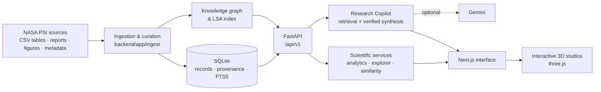

- **Ingestion** (`backend/app/ingest/`) parses the NASA files deterministically and writes only to `processed/`. Raw
  cells are preserved next to the parsed values, and the original NASA folders are never modified.
- **The knowledge graph** links investigations, experiments, documents, materials and findings (1,588 nodes and 7,223
  edges in the full local build). The Research-to-Safety Explorer and the Copilot both query it.
- **The Copilot** runs whitelisted tools and hybrid document search, then passes only that evidence to the model.
  Code checks that every cited id exists and that every number appears in the cited evidence; statements that fail
  are removed.
- **The frontend** calls the backend through a same-origin `/api/v1` proxy, so API keys never reach the browser.

## Installation and Local Demo

### Prerequisites

- Python 3.11+ (tested on 3.13)
- Node.js 20+ and npm
- No GPU and no model downloads required. A Gemini API key is optional.

### 1. Clone and configure (Windows CMD)

```bat
git clone https://github.com/COngtuthien/NASA-Hackathon.git
cd NASA-Hackathon
copy .env.example .env
```

All settings in `.env` are optional. To enable AI-written answers, set your own key:

```ini
LLM_PROVIDER=gemini
LLM_MODEL=gemini-3.8-flash
LLM_API_KEY=<your-google-ai-studio-key>
```

Without a key, the Copilot runs in **evidence-only mode**: search, tools and citations still work, and no text is
AI-written. Never commit `.env`.

### 2. Backend setup and data build (Windows CMD)

```bat
cd backend
python -m venv .venv
.venv\Scripts\python -m pip install -r requirements.txt
.venv\Scripts\python -m app.ingest.run
```

`app.ingest.run` builds `processed/spacefire.db`, the search index and the knowledge graph from the files in the
repository (about 15 s).

### 3. Frontend setup (Windows CMD)

```bat
cd ..\frontend
npm install
```

### 4. Run the application

Open two CMD windows from the repository root.

```bat
:: Window 1 — backend API
cd backend
.venv\Scripts\python -m uvicorn app.main:app --host 127.0.0.1 --port 8000
```

```bat
:: Window 2 — frontend (development mode)
cd frontend
npx next dev --port 3000
```

For a production build instead of development mode, run `npm run build` and then `npx next start --port 3000` in
`frontend`. The frontend proxies `/api/v1` to `BACKEND_URL` (default `http://127.0.0.1:8000`).

Open **http://localhost:3000**. The API documentation is at http://127.0.0.1:8000/docs.

### 5. Open the Guided Demo

Go to **http://localhost:3000/demo**, or press **Start guided demo** on the Home page. The demo bar walks you through
the challenge, a research scenario, NASA evidence, a 3D studio and the Research Copilot, with presenter notes on each
step.

<details>
<summary><b>PowerShell, Linux/macOS scripts and alternate ports</b></summary>

**PowerShell** (one-step setup and start, backend on 8000 and frontend on 3000):

```powershell
powershell -ExecutionPolicy Bypass -File scripts\setup.ps1
powershell -ExecutionPolicy Bypass -File scripts\start.ps1          # add -Prod for a production build
```

**Linux / macOS:**

```bash
bash scripts/setup.sh
bash scripts/start.sh
```

**Running beside another local instance (Windows CMD).** Build into a separate folder and serve it on other ports:

```bat
:: Backend on 8010
cd backend
.venv\Scripts\python -m uvicorn app.main:app --host 127.0.0.1 --port 8010
```

```bat
:: Frontend on 3010, built once into .next-verify
cd frontend
set "NEXT_DIST_DIR=.next-verify"
set "BACKEND_URL=http://127.0.0.1:8010"
npx next build
npx next start --port 3010
```

Run `npx next build` only once (or after code changes). Later runs can reuse the existing `.next-verify` build with
only the two `set` lines and `npx next start`. A custom `NEXT_DIST_DIR` build may rewrite `frontend/tsconfig.json`;
revert that change before committing.

</details>

### What a fresh clone includes

| Included in Git | Local only (not committed) |
|---|---|
| FLEX, BASS-II and SAFFIRE-I source folders (data and documents) | Source folders of the seven other investigations (`ACME CFI-G/`, `ACME Flame Design/`, `ACME BRE/`, `SAME/`, `PSI-117/`, `FLEX-2/`, `PSI-62/`) |
| Verified, curated derivatives of all seven in `processed/curated/phase13/` | Their 30 report and document files for full-text search |

Every structured dataset, chart, Explorer collection and 3D studio works from a fresh clone. Full-text document search
and Copilot passages for the seven Phase 13 investigations need their original NASA files, which can be downloaded from
the PSI links in the dataset table. Rebuilding the curated tables from those folders uses
`python -m app.ingest.phase13.run`.

### Tests

```bat
cd backend
.venv\Scripts\python -m pytest
cd ..\frontend
npx playwright test
```

Browser tests use the running servers (set `PW_BASE_URL` and `PW_API_PORT` to point at other ports). The model is never
called unless you opt in with `E2E_LIVE_LLM=1`. The latest recorded results are in
[`docs/PHASE16_TEST_RESULTS.md`](docs/PHASE16_TEST_RESULTS.md).

## Scientific Accuracy and Limitations

SpaceFire AI supports **scientific exploration and interpretation**. It is not a predictive or safety system.

- **The 3D scenes are conceptual educational visualizations.** They explain the physics. Measured NASA values appear
  separately and are labelled as such. Guided timelines are not the timeline of any specific test.
- **Measurements, model results, conditions and report statements are kept apart** and labelled by evidence class.
- **Not every investigation has numerical outcomes.** Flame Design is conditions only, BRE has day-level summaries,
  FLEX-2 has a test plan, PSI-62 has metadata only, and PSI-117 contains published figure series, not tests.
- **The Research-to-Safety ranking is research relevance, not fire risk.** Its weights are a documented design
  choice ([`docs/PHASE14_RANKING_METHODOLOGY.md`](docs/PHASE14_RANKING_METHODOLOGY.md)).
- **SpaceFire is not a safety-certification system.** The Copilot declines requests for safe thresholds, certifications or
  fire predictions.
- **The FLEX Burn-Time Estimator is exploratory.** It is a statistical estimate within FLEX conditions (median error
  about 35 %), not a validated physical simulation ([`docs/PHASE16_PREDICTION_REVIEW.md`](docs/PHASE16_PREDICTION_REVIEW.md)).
- **AI verification checks citations and numbers, not reasoning.** Free-tier Gemini quotas can limit AI-written
  answers; the Copilot then falls back to evidence only.

## Project Structure

```
NASA-Hackathon/
├── backend/
│   ├── app/
│   │   ├── api/v1/          # FastAPI routes
│   │   ├── ingest/          # deterministic parsing, curation, knowledge graph build
│   │   ├── services/        # analytics, explorer, combustion, similarity, retrieval, assistant, ml
│   │   ├── providers/       # LLM (Gemini, Anthropic) and scholarly search clients
│   │   ├── curation/        # reviewed evidence links
│   │   └── eval/            # retrieval and AI evaluation harnesses
│   └── tests/               # pytest suite
├── frontend/
│   ├── app/                 # Next.js routes (/, /safety-explorer, /experiments, /phenomena/*, /copilot, /demo, ...)
│   ├── components/          # views, 3D scenes, studios, demo bar, UI system
│   ├── lib/                 # API client, timelines, demo journeys, media registry
│   ├── e2e/                 # Playwright tests
│   └── public/media/        # verified NASA media (WebP)
├── processed/curated/       # committed, verified derivatives of the NASA sources
├── research/                # data inventory and scientific analysis notes
├── docs/                    # methods, design notes, phase reports, screenshots
├── scripts/                 # setup / start / smoke-test scripts
├── FLEX/  BASS-II/  SAFFIRE-1/   # NASA PSI source data (read-only)
└── .env.example
```

## Credits and Data Sources

- **Scientific data:** NASA Physical Sciences Informatics (PSI) system, investigations PSI-69, PSI-68, PSI-117,
  PSI-159, PSI-10, PSI-20, PSI-25, PSI-62, PSI-102 and PSI-98 (links in the [dataset table](#nasa-datasets)). All
  credit for the experiments, measurements and reports goes to the NASA principal investigators and research teams of
  these investigations.
- **Media:** NASA photographs, footage and animations, each credited and linked to its NASA record in the app.
  Sources and usage notes are in [`docs/SCIENTIFIC_MEDIA_SOURCES.md`](docs/SCIENTIFIC_MEDIA_SOURCES.md).
- **Literature metadata:** NASA NTRS, OpenAlex and Crossref, attributed and linked. Abstracts are stored only when the
  provider API returns them; external full texts are never downloaded.
- **Data rights:** NASA PSI public data. The original dataset folders are never modified, and tests verify their
  SHA-256 hashes.

SpaceFire AI was created for the NASA Space Apps Challenge 2026. NASA does not endorse this project. This repository
does not include a license file.

## Further Documentation

| Topic | Document |
|---|---|
| Scientific methods and assumptions | [`docs/SCIENTIFIC_METHODS.md`](docs/SCIENTIFIC_METHODS.md) |
| Combustion Explorer and evidence levels | [`docs/PHASE16_COMBUSTION_EXPLORER.md`](docs/PHASE16_COMBUSTION_EXPLORER.md) |
| Knowledge graph | [`docs/PHASE14_KNOWLEDGE_GRAPH.md`](docs/PHASE14_KNOWLEDGE_GRAPH.md) |
| Ranking methodology | [`docs/PHASE14_RANKING_METHODOLOGY.md`](docs/PHASE14_RANKING_METHODOLOGY.md) |
| Interactive 3D science | [`docs/INTERACTIVE_SCIENTIFIC_ANALYSIS_V2.md`](docs/INTERACTIVE_SCIENTIFIC_ANALYSIS_V2.md) |
| Demo walkthrough | [`docs/PHASE15_DEMO_GUIDE.md`](docs/PHASE15_DEMO_GUIDE.md) |
| Implementation status and history | [`docs/IMPLEMENTATION_STATUS.md`](docs/IMPLEMENTATION_STATUS.md) |
